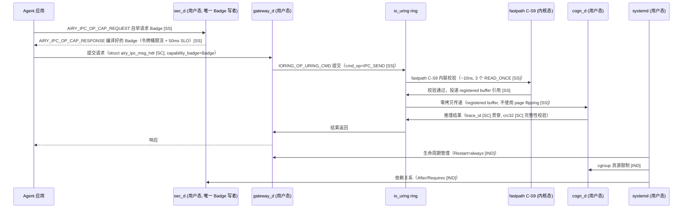
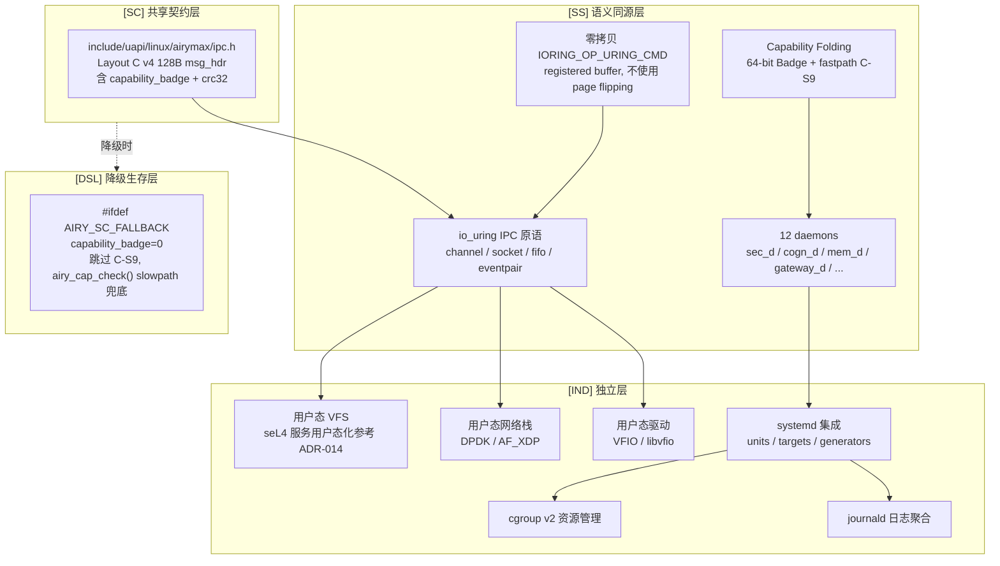

Copyright (c) 2025-2026 SPHARX Ltd. All Rights Reserved.

# agent-linux 服务设计文档

> **文档定位**：agent-linux 服务设计文档（Airymax Services 极境服务）\
> **文档版本**：v1.0.1\
> **上级文档**：[agent-linux 设计文档](README.md)\
> **核心约束**：IRON-9 v3 同源且部分代码共享——与 agentrt 用户态 daemons 通过 \[SC] 共享契约层 + \[SS] 语义同源层协作，\[IND] 用户态 VFS/网络栈/驱动框架/systemd 集成实现独立\
> **子仓编号**：02\
> **子仓代号**：极境服务（Airymax Services）\
> **设计基准**：用户态系统服务 + 消息传递通信 + systemd 集成 + io\_uring 零拷贝 IPC\
> **同源 agentrt**：daemons（12 daemons）\
> **横切关注点**：服务是横切关注点（cross-cutting concern），贯穿调度（daemon 生命周期）、IPC（io\_uring 通道）、eBPF（服务观测）、记忆卷载（VFS 持久化）4 大数据流

***

## 目录

- [1. 子仓职责](#1-子仓职责)
- [2. 同源关系（IRON-9 v3 四层共享模型）](#2-同源关系iron-9-v3-四层共享模型)
- [3. 目录结构](#3-目录结构)
- [4. 核心特性](#4-核心特性)
- [5. 微内核思想体现](#5-微内核思想体现)
- [6. IRON-9 v3 四层共享模型落地](#6-iron-9-v3-四层共享模型落地)
- [7. agent-linux 工程基线](#7-agent-linux-工程基线)
- [8. 前沿理论参考](#8-前沿理论参考)
- [9. 与其他子仓的协作](#9-与其他子仓的协作)
- [10. 里程碑（M0-M8）](#10-里程碑m0-m8)
- [11. agentrt 一致性检查](#11-agentrt-一致性检查)
- [12. 相关文档](#12-相关文档)
- [13. 参考](#13-参考)

***

## 1. 子仓职责

`services` 是 agent-linux（AirymaxOS）的用户态系统服务子仓，承担以下核心职责：

1. **用户态 VFS \[IND]**：文件系统实现下放至用户态服务，内核仅保留虚拟文件系统层。
2. **用户态网络栈 \[IND]**：基于 DPDK/AF\_XDP 实现高性能用户态网络协议栈。
3. **用户态驱动框架 \[IND]**：基于 VFIO/libvfio 将设备驱动下放至用户态进程。
4. **12 daemons 集成 \[SS]**：将 agentrt 的 12 个核心守护进程注册为 OS 级守护服务，与 systemd 集成。daemon 语义与 agentrt 同源。
5. **消息传递通信 \[SS]**：基于 io\_uring 构建零拷贝、零 syscall 的消息传递基础设施。IPC 消息头与操作码 \[SC] 与 agentrt 共享。

### 1.1 横切关注点声明

服务是横切关注点（cross-cutting concern），贯穿 agent-linux 全部 4 大数据流：

| 数据流      | 服务切入点                                   | 同源标注   |
| -------- | --------------------------------------- | ------ |
| 调度数据流    | daemon 生命周期管理（systemd unit + cgroup）    | \[IND] |
| IPC 数据流  | io\_uring 零拷贝通道 + 128B 消息头              | \[SC]  |
| eBPF 数据流 | daemon 观测（uprobe/tracepoint + journald） | \[SS]  |
| 记忆卷载数据流  | VFS 持久化层 + daemon 状态快照                  | \[IND] |

***

## 2. 同源关系（IRON-9 v3 四层共享模型）

依据 IRON-9 v3 决策，agentrt（用户态 daemons）与 agent-linux（用户态 services）通过四层共享模型协作（\[SC] 共享契约 + \[SS] 语义同源 + \[IND] 完全独立 + \[DSL] 降级生存）：

| 层次               | 共享程度                               | 服务子系统内容                                                                                                                                                                                                                                    | 组织方式                                 |
| ---------------- | ---------------------------------- | ------------------------------------------------------------------------------------------------------------------------------------------------------------------------------------------------------------------------------------------ | ------------------------------------ |
| **\[SC] 共享契约层**  | 完全共享代码                             | IPC 消息头（magic 0x41524531 'ARE1'）、128B 消息头结构（`struct airy_ipc_msg_hdr`，含 `capability_badge` + `crc32` 字段）、SQE/CQE 操作码与标志位、ring 创建/注册参数、Badge 位布局宏、Capability 权限位                                                                                                                  | `include/uapi/linux/airymax/ipc.h`（与 kernel 共享） |
| **\[SS] 语义同源层**  | 高层 API 语义同源（概念操作一致），签名因抽象层级不同而独立演进 | 12 daemons 语义（sec\_d/cogn\_d/mem\_d/gateway\_d/logger\_d/macro\_d/audit\_d/sched\_d/dev\_d/net\_d/vfs\_d/config\_d）、io\_uring IPC 通信原语（channel/socket/fifo/eventpair）、消息传递范式、v1.0.1 Capability Folding Badge 校验语义、daemon 生命周期（init→run→stop）等 20 项 | 各自独立实现                               |
| **\[IND] 完全独立层** | 完全独立                               | 用户态 VFS 实现（seL4 服务用户态化参考，ADR-014）、用户态网络栈（DPDK/AF\_XDP）、用户态驱动框架（VFIO/libvfio）、systemd 集成、cgroup v2 资源管理、journald 日志聚合、具体文件系统实现（ext4/xfs/tmpfs/btrfs）                                                                                        | 各自独立仓库                               |
| **\[DSL] 降级生存层** | 最小生存子集                             | `#ifdef AIRY_SC_FALLBACK` 降级块：`capability_badge=0` 跳过 fastpath C-S9 校验、退化到 `airy_cap_check()` slowpath 兜底路径（基于 `agent_caps[1024]` 静态数组；`AIRY_ECAP_RADIX_MISS`/`STATIC_KEY` 保留编号但 v1.0.1 不触发）、opcode 集缩减至 2 种（SEND/RECV）、Fault 码禁用统一 Panic                                                            | 各自独立仓库（受 [SC] 头文件 `AIRY_SC_FALLBACK` 宏驱动） |

### 2.1 维度对比

| 维度        | agentrt（daemons）                | agent-linux（services）         | 同源标注   |
| --------- | ------------------------------- | ------------------------------- | ------ |
| 服务数量      | 12 daemons                      | 12 daemons + VFS/Net/Drivers    | \[SS]  |
| daemon 语义 | macro\_d/logger\_d/...   | macro\_d/logger\_d/...   | \[SS]  |
| IPC 消息头   | `struct airy_ipc_msg_hdr`（128B） | `struct airy_ipc_msg_hdr`（128B） | \[SC]  |
| IPC magic | 0x41524531 'ARE1'               | 0x41524531 'ARE1'               | \[SC]  |
| 通信方式      | 进程间消息队列                         | io\_uring 零拷贝 IPC               | \[SS]  |
| 通信原语      | 用户态 channel/socket/fifo         | io\_uring channel/socket/fifo   | \[SS]  |
| 服务管理      | 自研 supervisor                   | systemd 集成（agent-linux 标准）    | \[IND] |
| 部署形态      | 用户态进程                           | systemd unit + capability       | \[IND] |
| 跨平台       | Linux/macOS/Windows             | Linux 6.6 专属                    | \[IND] |

### 2.2 同源传承要点

- 保留 agentrt 的 12 daemons 语义（agent-linux 统一 `_d` 命名：sec_d/cogn_d/mem_d/gateway_d/logger_d/macro_d/audit_d/sched_d/dev_d/net_d/vfs_d/config_d；agentrt 旧称 macro_superv/logger_daemon/config_daemon 对应 macro_d/logger_d/config_d，见 90-terminology.md 旧称映射）\[SS]。
- 保留 agentrt 的"消息传递"通信范式（升级为 io\_uring 零拷贝实现）\[SS]。
- 保留 agentrt 的 capability 令牌传递语义（升级为内核态强制）\[SS]。
- IPC 消息头与操作码 \[SC] 共享，确保两端通信协议一致。
- 升级为 OS 级 systemd 服务，获得生命周期管理 + 资源限制 + 日志聚合 \[IND]。

***

## 3. 目录结构

```
services/
├── vfs/                   # 用户态 VFS [IND]
├── net/                   # 用户态网络栈（DPDK/AF_XDP）[IND]
├── drivers/               # 用户态驱动框架（VFIO/libvfio）[IND]
├── common/                # daemon 框架（主循环 / fd 事件源 / IPC 注册 / 心跳）[IND]
├── daemons/               # 12 daemons 集成（A-ULS 统一生命周期）[SS]
│   ├── macro_d/        # A-ULS：Macro-Supervisor
│   ├── logger_d/       # A-ULP：Logger Daemon
│   ├── config_d/       # A-UCS：配置管理守护
│   ├── gateway_d/           # 网关守护
│   ├── sched_d/             # 调度守护
│   ├── vfs_d/               # VFS 用户态服务
│   ├── net_d/               # 网络策略守护
│   ├── mem_d/               # 记忆管理守护
│   ├── cogn_d/              # 认知调度守护
│   ├── sec_d/               # 安全策略守护
│   ├── audit_d/             # 审计守护
│   └── dev_d/               # 设备驱动守护
├── systemd/               # systemd 集成（agent-linux 标准）[IND]
├── ipc/                   # 消息传递通信（基于 io_uring）[SS]
└── docs/
```

### 3.1 vfs/（用户态 VFS）\[IND]

参考 **seL4 服务用户态化模型**（ADR-014）：

- `vfs-service`：虚拟文件系统服务，处理路径解析、挂载管理 \[IND]。
- `fs-providers/`：具体文件系统实现（ext4、xfs、tmpfs、btrfs 等）作为独立服务 \[IND]。
- `io-channel`：基于 io\_uring channel 的文件操作协议 \[IND]。
- `vnode`：虚拟节点抽象，跨服务引用 \[IND]。

### 3.2 net/（用户态网络栈）\[IND]

- `dpdk/`：基于 DPDK 的高性能用户态网络栈 \[IND]。
- `af_xdp/`：基于 AF\_XDP 的零拷贝网络路径 \[IND]。
- `tcp-stack/`：用户态 TCP/IP 协议栈 \[IND]。
- `dns/`：用户态 DNS 解析器 \[IND]。
- `dhcp/`：用户态 DHCP 客户端 \[IND]。

### 3.3 drivers/（用户态驱动框架）\[IND]

基于 **VFIO/libvfio**：

- `libvfio/`：用户态驱动框架库 \[IND]。
- `pci-drivers/`：PCI 设备用户态驱动 \[IND]。
- `usb-drivers/`：USB 设备用户态驱动 \[IND]。
- `gpu-drivers/`：GPU 用户态驱动（与 `cognition/gpu-npu` 协作）\[IND]。
- `block-drivers/`：块设备用户态驱动 \[IND]。

### 3.4 daemons/（12 daemons）\[SS]

每个 daemon 均注册为 systemd 服务（`.service` unit），具备：

- capability 令牌（与 `security/capability` 协作）\[SS]。
- io\_uring IPC 通道（与其他 daemon 通信，消息头 \[SC] 共享）\[SS]。
- 资源限制（cgroup v2）\[IND]。
- 日志输出（journald 集成）\[IND]。

**12 daemons 清单**（统一归属 `services/daemons/`，A-ULS 统一生命周期 \[SS]）：

| 序号 | daemon           | 职责              | 同源标注  |
| -- | ---------------- | --------------- | ----- |
| 1  | `macro_d`   | 主监管守护进程（A-ULS）    | \[SS] |
| 2  | `logger_d`  | 日志消费守护进程（A-ULP）  | \[SS] |
| 3  | `config_d`  | 配置管理守护进程（A-UCS）   | \[SS] |
| 4  | `gateway_d`      | 网关守护进程           | \[SS] |
| 5  | `sched_d`        | 调度守护进程           | \[SS] |
| 6  | `vfs_d`          | VFS 用户态服务守护进程    | \[SS] |
| 7  | `net_d`          | 网络策略守护进程         | \[SS] |
| 8  | `mem_d`          | 记忆管理守护进程         | \[SS] |
| 9  | `cogn_d`         | 认知调度守护进程         | \[SS] |
| 10 | `sec_d`          | 安全策略守护进程         | \[SS] |
| 11 | `audit_d`        | 审计守护进程           | \[SS] |
| 12 | `dev_d`          | 设备驱动守护进程         | \[SS] |

### 3.5 systemd/（systemd 集成）\[IND]

遵循 **agent-linux 基础系统治理组** 标准：

- `units/`：systemd unit 文件目录 \[IND]。
- `targets/`：systemd target 定义（airymaxos.target 等）\[IND]。
- `generators/`：systemd generator（动态生成 unit）\[IND]。
- `analyze/`：systemd-analyze 性能分析配置 \[IND]。

### 3.6 ipc/（消息传递通信）\[SS]

基于 **io\_uring** 零拷贝 IPC，IPC 消息头 \[SC] 与 agentrt 共享：

- `io-uring-ipc`：核心 IPC 库 \[SS]。
- `channel`：双向通道抽象（参考 seL4 Endpoint）\[SS]。
- `socket`：面向连接的 socket 抽象（参考 seL4 Endpoint）\[SS]。
- `fifo`：单向 FIFO 抽象（参考 seL4 Notification）\[SS]。
- `eventpair`：事件同步原语（参考 seL4 Notification）\[SS]。

### 3.7 common/（daemon 框架）\[IND]

12 个 daemon 共用的事件驱动框架，只提供机制，不承载业务：

- `include/airy/daemon.h`：公共契约唯一权威源——daemon 生命周期状态机
  （`AIRY_DMN_INIT/RUNNING/STOPPING/STOPPED`）、fd 事件源
  （`AIRY_DMN_IN/OUT/ERR/HUP`）、`struct airy_dmn_cfg`、`struct airy_dmn_ops`、
  `struct airy_dmn_src`、`struct airy_dmn_frame` 与 15 个 `airy_dmn_*()`
  原型。
- `daemon/dmn_int.h`：内部契约——统一事件源表（`enum airy_dmn_kind` +
  回调联合体）、`struct airy_dmn` 上下文与槽位上限；仅供实现分片包含，
  不对外安装。
- `daemon/dmn_core.c`：对象生命周期——`airy_dmn_new/free/reg` 与
  `state/name/now` 查询，入参校验、name/config 按值复制、自持描述符关闭。
- `daemon/dmn_event.c`：fd 事件源表与 epoll 注册——`airy_dmn_add/del`、
  事件掩码映射（`AIRY_DMN_IN/OUT/ERR/HUP` → `EPOLLIN/OUT/ERR/RDHUP`）、
  惰性 `epoll_create1(EPOLL_CLOEXEC)` 与 `errno → -AIRY_E*` 收敛；槽位
  下标即 epoll `data.u32`，外部已关闭描述符按已注销处理。内部
  `airy_dmn_mask/attach/detach` 供 IPC 通道注册分片复用。
- `daemon/dmn_loop.c`：主循环与周期 tick——`airy_dmn_run/stop`、
  `start → epoll → stop` 生命周期、按单调时钟截止点的 tick 调度与
  回调负值传播；框架自持 `eventfd` 唤醒源（`AIRY_DMN_CTL` 哨兵，
  不占事件槽位），使 `airy_dmn_stop()` 在无外部事件时立即打断
  `epoll_wait()`。signalfd 以 `AIRY_DMN_SIG` 哨兵进入同一循环。
  ERR/HUP 不受注册掩码过滤，避免对端关闭后反复唤醒空转。
- `daemon/dmn_sig.c`：信号收口——`AIRY_DMN_F_SIG` 生效时阻塞
  SIGTERM/SIGINT/SIGHUP 并创建 `signalfd(SFD_CLOEXEC|SFD_NONBLOCK)`，
  SIGTERM/SIGINT 置停止请求、SIGHUP 调用 `ops.reload` 热加载；
  信号以描述符事件分派，不使用异步处理函数。主循环退出后恢复
  运行前的线程信号掩码，多线程 daemon 须在创建线程前自行阻塞。
- `daemon/dmn_beat.c`：心跳记账——`airy_dmn_beat()` 以 C11 原子量
  刷新 `last_beat`，`airy_dmn_live()` 按 `beat_ms * miss_max` 容忍
  窗口判断新鲜度；两者可在不同线程并发调用，时钟取单调毫秒，只做
  相对比较。
- `daemon/dmn_crc.c`：IPC 消息完整性摘要——`airy_dmn_crc()` 按 C-S12
  计算 `header[0:52)` 与 payload 的 CRC32，不覆盖 `crc32` 字段自身与
  `reserved[72]`；算法与内核 `airy_crc32_calc()` 等价（zlib
  `crc32(0, buf, len)`），发送与接收共用同一实现，避免两侧摘要漂移。
- `daemon/dmn_ipc.c`：IPC 通道注册、收发与整帧分派——`airy_dmn_ipc()`
  仅接受 `SOCK_SEQPACKET`/`SOCK_DGRAM`（`SO_TYPE` 校验），与 fd 事件源
  共用 `airy_dmn_find()` 查重，同一描述符不占两个槽位；`airy_dmn_send()`
  校验 magic、C-S10 保留标志位、C-S4 全零 reserved 与 payload_len 上界
  后盖写 C-S12 摘要，以 128 字节头加消息体单次写出，调用方头副本不被
  修改。读取先用 `MSG_PEEK|MSG_TRUNC` 取整帧长度，再单次读入并校验
  magic、标志位、`payload_len`、reserved 与摘要，回调后释放帧缓冲。
  非阻塞描述符无帧可读时按成功返回并等待下一次唤醒；帧过短、头部字段
  或摘要不符、对端关闭均以负值终止主循环（`-AIRY_EIPC_*` 定位到具体
  契约项），不做字节流重同步；一条消息须由单次 send 写入同一条记录或
  数据报。`airy_dmn_batch()` 承载 `AIRY_IPC_OP_SEND_BATCH` 批量发送：
  先校验全部帧再写出，任一帧非法时零发送、不留半批；opcode 统一盖写为
  批量值，仅全局末帧置 `AIRY_IPC_FLAG_BATCH_TAIL`、其余帧清除该位，
  每帧按 C-S12 独立计算摘要；按固定上限分块 `sendmmsg()`，栈占用有界
  且不分配堆内存；`*done` 报告已完整写出的帧数，部分写出返回
  `-AIRY_EAGAIN`，调用方只能从该位置续发，重发整批会产生重复消息。
  io_uring_cmd 提交路径随内核字符设备就绪后接入同一分派抽象。
- 构建目标 `airy_daemon` 为 STATIC 库并链接 zlib：导出头文件与 [SC]
  头搜索路径，实现分片随各任务逐步并入。
- [SC] 头通过 `-idirafter` 引用 `kernel/include/uapi`，避免遮蔽 glibc 的
  `<linux/*>`。

***

## 4. 核心特性

### 4.1 VFS 用户态化（参考 seL4 服务用户态化，ADR-014）\[IND]

**架构**：

- 内核保留虚拟文件系统层（VFS layer），仅负责路径解析、inode 缓存 \[IND]。
- 具体文件系统实现（ext4、xfs、tmpfs）作为独立用户态服务运行 \[IND]。
- 文件操作通过 io\_uring channel 在 VFS 服务与 FS 服务之间传递 \[SS]。

**优势**：

- 文件系统 bug 不会导致内核 panic \[IND]。
- 可独立重启文件系统服务 \[IND]。
- 支持热加载新文件系统 \[IND]。

### 4.2 网络栈用户态化（DPDK/AF\_XDP）\[IND]

**架构**：

- DPDK 模式：完全绕过内核，直接在用户态轮询网卡 \[IND]。
- AF\_XDP 模式：通过 XDP 程序将数据包重定向至用户态 socket \[IND]。
- 用户态 TCP/IP 协议栈 \[IND]。

**优势**：

- 高性能：单核可处理 100+ Gbps 流量 \[IND]。
- 可演进：协议栈可独立升级 \[IND]。
- 隔离性：协议栈漏洞不影响内核 \[IND]。

### 4.3 驱动框架用户态化（VFIO/libvfio）\[IND]

**架构**：

- 通过 VFIO 框架将 PCIe 设备 DMA 直通至用户态进程 \[IND]。
- 用户态驱动通过映射设备 MMIO 寄存器与 DMA 缓冲区操作设备 \[IND]。
- 中断处理通过 eventfd 传递至用户态 \[IND]。

**优势**：

- 驱动 bug 不影响内核 \[IND]。
- 可用 Rust 编写安全驱动（与 `kernel/patches/rust-drivers` 协作）\[IND]。
- 可独立重启驱动服务 \[IND]。

### 4.4 12 daemons 注册为 OS 级守护服务 \[SS]

将 agentrt 的 12 个核心守护进程注册为 systemd 服务，daemon 语义 \[SS] 与 agentrt 同源，获得：

- 生命周期管理（启动、停止、重启）\[IND]。
- 依赖关系管理（After/Requires）\[IND]。
- 资源限制（cgroup v2）\[IND]。
- 日志聚合（journald）\[IND]。
- 崩溃自动重启（Restart=always）\[IND]。

**systemd unit 示例**（gateway\_d）：

```ini
[Unit]
Description=agent-linux Gateway Daemon
After=network.target airymaxos-ipc.target
Requires=airymaxos-ipc.target

[Service]
Type=notify
ExecStart=/usr/lib/airymaxos/daemons/gateway_d
CapabilityBoundingSet=CAP_NET_BIND_SERVICE CAP_DAC_OVERRIDE
Restart=always
RestartSec=1s
Slice=agent.slice

[Install]
WantedBy=airymaxos.target
```

### 4.5 消息传递通信（基于 io\_uring 零拷贝）\[SS]

**通信原语**（参考 seL4 Endpoint/Notification，ADR-014，语义 \[SS] 同源 agentrt）：

| 原语        | 语义      | 用途      | 同源标注  |
| --------- | ------- | ------- | ----- |
| Channel   | 双向、面向消息 | RPC 调用  | \[SS] |
| Socket    | 双向、面向流  | 流式数据传输  | \[SS] |
| FIFO      | 单向、面向消息 | 高吞吐单向通信 | \[SS] |
| Eventpair | 事件同步    | 跨进程信号量  | \[SS] |

**IPC 消息头** \[SC]（`include/uapi/linux/airymax/ipc.h`，与 agentrt 共享，Layout C v4）：

```c
/* IPC 128B 消息头定义见 [SC] 共享契约层（SSoT），不就地重定义 */
#include <airymax/ipc.h>
/* 结构体名称：struct airy_ipc_msg_hdr（Layout C v4，物理宿主见
 * 50-engineering-standards/120-cross-project-code-sharing.md §2.7）
 *
 * 字段顺序（D-9 修复后 8 字节自然对齐）：
 *   offset  0: magic            (__u32)  0x41524531 'ARE1'
 *   offset  4: opcode           (__u16)  AIRY_IPC_OP_*
 *   offset  6: flags            (__u16)  AIRY_IPC_FLAG_*
 *   offset  8: trace_id         (__u64)  OpenTelemetry trace ID
 *   offset 16: timestamp_ns     (__u64)  CLOCK_REALTIME ns
 *   offset 24: src_task         (__u64)  source Agent/daemon task_id
 *   offset 32: dst_task         (__u64)  destination Agent/daemon task_id
 *   offset 40: capability_badge (__u64)  [SS] Capability Folding Badge（sec_d 编译）
 *   offset 48: payload_len      (__u32)  payload length
 *   offset 52: crc32            (__u32)  CRC32 over header[0:52) + payload
 *   offset 56: reserved[72]     (__u8)   must be zero
 *   总计 128 字节 = 2 cache lines
 */
```

> **SSoT 声明**：本节 IPC 128B 消息头不再就地定义，以 `include/uapi/linux/airymax/ipc.h`（物理宿主见 `50-engineering-standards/120-cross-project-code-sharing.md` §2.7）为单一数据源。结构体名称为 `struct airy_ipc_msg_hdr`，D-9 修复后使用 `__aligned(64)` 对齐（移除 packed 属性，参考 OLK 6.6 `struct ethhdr`/`struct iphdr` 手动安排字段自然对齐的做法）与 `__u32`/`__u16`/`__u64`/`__u8` UAPI 类型。v1.0.1 Capability Folding 后新增 `capability_badge`（offset 40，承载 64-bit Native Word Badge：`Epoch<<48 | RandomTag<<16 | Perms`）与 `crc32`（offset 52，覆盖 `header[0:52) + payload`）字段，`reserved` 收缩至 72 字节。

**零拷贝路径** \[SS]（不使用 page flipping，改用 `alloc_pages + mmap` + registered buffer）：

- 发送方通过 `alloc_pages` 分配物理页，`vm_map_pages` / `remap_pfn_range` 映射至用户态，并注册为 io\_uring registered buffer \[SS]。
- 接收方通过 `IORING_OP_URING_CMD`（`cmd_op=AIRY_URING_CMD_IPC_SEND/IPC_SEND_BATCH/IPC_CANCEL/IPC_FREEZE/IPC_CAP_REQUEST`）复用入口接收 registered buffer 引用，内核仅传递 page 引用，不拷贝数据、不翻转 page table entry \[SS]。
- **禁止使用 page flipping**（不交换物理页、不破坏内存布局稳定性），对齐 `airy_defconfig` 强制 `CONFIG_IO_URING=y` 且 page flipping 相关代码路径不编译的工程规范 \[IND]。
- **禁止使用 DMA 一致性内存**（不调用 `dma_alloc_coherent`），共享内存构建目标绑定 `alloc_pages + mmap` 实现源文件 \[IND]。
- 跨节点 IPC 由 `gateway_d` daemon 承载（gRPC over QUIC/TCP + mTLS），入站时重新编译 Badge，不污染单节点 fastpath C-S9（详见 [30-interfaces/02-ipc-protocol.md §9](../30-interfaces/02-ipc-protocol.md)）\[IND]。

### 4.6 v1.0.1 Capability Folding 在 services 层的落地 \[SS]

v1.0.1 Capability Folding 将 capability check 从独立控制面操作"折叠"到 IPC 数据面 fastpath 中，IPC 消息头 offset 40 的 `capability_badge` 字段承载 64-bit Native Word Badge（`Epoch<<48 | RandomTag<<16 | Perms`），由 fastpath C-S9 内联校验（~10ns），无双平面、无独立 capability syscall。services 子仓作为 12 daemon 的物理宿主，承载以下 Capability Folding 职责：

**4.6.1 12 daemon 在 services 子仓中的实现** \[SS]

| 序号 | daemon         | services 层职责                                          | Capability Folding 角色                         |
| -- | -------------- | ----------------------------------------------------- | --------------------------------------------- |
| 1  | `sec_d`        | Badge 编译/撤销/LSM\_ctl/Wasm\_load 专属管理入口（`airy_sys_call` 编号 0） | **唯一 Badge 写者**：编译 `agent_caps[src_task]`，令牌桶限流 + 50ms SLO |
| 2  | `cogn_d`       | 认知调度守护，CoreLoopThree 阶段通知                              | Badge 携带者：推理请求经 C-S9 校验后投递至 kthread            |
| 3  | `mem_d`        | 记忆卷载守护                                                | Badge 携带者：记忆快照 IPC 经 C-S9 校验                  |
| 4  | `gateway_d`    | 跨节点网关守护                                               | **入站 Badge 重新编译**：跨节点消息入站时重新编译为目标节点 Badge      |
| 5  | `logger_d`     | 日志消费守护（A-ULP）                                         | Badge 携带者：审计日志 IPC 经 C-S9 校验                  |
| 6  | `macro_d` | 主监管守护（A-ULS）                                          | Badge 携带者：通过 `AIRY_IPC_OP_FREEZE` 冻结违规 Agent ring |
| 7  | `audit_d`      | 审计守护                                                  | Badge 携带者：审计事件 IPC 经 C-S9 校验                  |
| 8  | `sched_d`      | 调度守护                                                  | Badge 携带者：调度策略 IPC 经 C-S9 校验                  |
| 9  | `dev_d`        | 设备驱动守护                                                | Badge 携带者：设备访问 IPC 经 C-S9 校验                  |
| 10 | `net_d`        | 网络策略守护                                                | Badge 携带者：网络策略 IPC 经 C-S9 校验                  |
| 11 | `vfs_d`        | VFS 用户态服务守护                                           | Badge 携带者：文件操作 IPC 经 C-S9 校验                  |
| 12 | `config_d`| 配置管理守护（A-UCS）                                         | Badge 携带者：配置读写 IPC 经 C-S9 校验                  |

**4.6.2 sec_d 串行化 Badge 编译** \[SS]

`sec_d` 是 `agent_caps[1024]` 静态数组（128KB）的**唯一写者**，通过 `airy_sys_call`（编号 0）接收 Badge 编译/撤销请求。为防止 Badge 编译风暴，sec_d 采用**令牌桶限流**：

- 令牌桶容量：默认 100 req/s，突发 150（对齐 `gateway_d` 速率限制基线）
- Badge 编译 SLO：P99 < 50ms（含 `get_random_bytes()` 生成 RandomTag + 写入 `agent_caps[]`）
- 超限触发 `AIRY_ESEC_D_THROTTLED = -83`（扩展错误码），调用方退避重试
- 撤销操作 O(1)：`airy_cap_epoch_bump(agent_id)` per-agent 定向失效（K9-1 主要机制），16-bit Epoch 回绕触发 `airy_cap_epoch_rollover_total` CRITICAL 告警

**4.6.3 io_uring fastpath C-S9 Badge 内联校验在 services 层的体现** \[SS]

services 层的 12 daemon 通过 `IORING_OP_URING_CMD` 提交 IPC 消息时，fastpath C-S9 在内核态内联校验 `capability_badge`（~10ns，3 个 `READ_ONCE` + 位运算）：

1. 提取 `badge_epoch = AIRY_BADGE_EPOCH(badge)`，比对 `slot_epoch`（`READ_ONCE(agent_caps[src_task].epoch)`，per-agent）→ 不匹配返回 `AIRY_ECAP_EPOCH`(-79)
2. 提取 `badge_randtag = AIRY_BADGE_RANDTAG(badge)`，比对 `READ_ONCE(agent_caps[src_task].randtag)` → 不匹配返回 `AIRY_ECAP_FORGED`(-80) 同时触发 `AIRY_FAULT_CAP_FORGED`(0x1001)
3. 提取 `badge_perms = AIRY_BADGE_PERMS(badge)`，比对 opcode 所需权限位 → 不满足返回 `AIRY_ECAP_PERM`(-81)
4. Ring 冻结检查（C-S0）：`ring->frozen == true` → 返回 `AIRY_EIPC_FROZEN`(-53)
5. slowpath LSM 钩子（`security_uring_cmd`，单参数 `struct io_uring_cmd *ioucmd`）仅在 C-S9 失败时调用，做策略裁决与冷酷执法

**4.6.4 OLK 6.6 工程规范** \[IND]

services 层 io\_uring IPC 实现严格遵循 OLK 6.6 工程规范：

- **`io_uring_cmd_to_pdu(cmd, pdu_type)`**：访问 `struct io_uring_cmd` 的 `pdu[32]` 内联数据区的安全宏，fastpath 路径仅依赖前 32 字节时使用
- **`io_uring_cmd_done(cmd, ret, res2, issue_flags)`**：4 参数完成接口，`issue_flags` 必须使用核心 io\_uring 代码传入的 mask（如 `IO_URING_F_NONBLOCK` / `IO_URING_F_IOWQ`），禁止硬编码
- **`security_uring_cmd` LSM 钩子**：单参数 `struct io_uring_cmd *ioucmd`，由 `airy_lsm` 在 `LSM_ORDER_MUTABLE`（默认值，非 `LSM_ORDER_FIRST`）下注册，仅在 fastpath C-S9 失败时被调用
- **SQE128 模式**（`IORING_SETUP_SQE128`）：`cmd` 字段从标准 16 字节扩展至 80 字节（16→80），承载 `airy_ipc_cmd` 结构体（≤ 80 字节，`BUILD_BUG_ON(sizeof(struct airy_ipc_cmd) > 80)` 编译期校验）
- **`airy_lsm` 模块**：物理宿主 `security/airy/`（非 `security/airymax/`），`CONFIG_SECURITY_AIRY` default 'n'
- **UAPI 标准路径**：`include/uapi/linux/airymax/`（12 个 [SC] 共享契约头文件物理宿主）

***

## 5. 微内核思想体现

### 5.1 服务用户态化 \[IND]

遵循 **seL4** 服务用户态化原则（ADR-014）：

- 所有系统服务（VFS、网络、驱动）均运行在用户态 \[IND]。
- 服务通过消息传递通信 \[SS]。
- 服务崩溃可被监督进程重启 \[IND]。

### 5.2 消息传递通信 \[SS]

遵循 **seL4 消息传递** 模型（Endpoint/Notification，ADR-014）：

- 进程间通信通过内核仲裁的消息传递 \[SS]。
- 消息携带 capability 令牌 \[SS]。
- 零拷贝通过 IORING_OP_URING_CMD + registered buffer 实现 \[SS]。

### 5.3 服务隔离 \[IND]

每个服务运行在独立地址空间：

- 进程级隔离（MMU）\[IND]。
- capability 限制（最小权限）\[SS]。
- seccomp 过滤（系统调用白名单）\[IND]。
- Landlock 沙箱（文件访问控制）\[SS]。

***

## 6. IRON-9 v3 四层共享模型落地

### 6.1 \[SC] 共享契约层——`include/uapi/linux/airymax/ipc.h`

服务模块的 \[SC] 层通过 `include/uapi/linux/airymax/ipc.h` 与 agentrt 共享（与 kernel 共享同一头文件）：

| 内容                                                         | 说明                                                                                                                |
| ---------------------------------------------------------- | ----------------------------------------------------------------------------------------------------------------- |
| `AIRY_IPC_MAGIC`（0x41524531 'ARE1'）                        | IPC 消息头 magic（同源 agentrt）                                                                                         |
| `AIRY_IPC_HDR_SIZE`（128）                                     | 128B 消息头大小                                                                                                        |
| `AIRY_IPC_RING_DEF/MAX_ENTRIES`（256/32768）                 | ring 默认/最大条目数                                                                                                     |
| `AIRY_IPC_OP_*` 宏（SEND/RECV/SEND\_BATCH/CANCEL）            | SQE 操作码                                                                                                           |
| `AIRY_IPC_SQE_*` 宏（FIXED\_BUF/ASYNC/BUF\_SELECT/SKIP\_CQE） | SQE 标志位                                                                                                           |
| `AIRY_IPC_CQE_F_*` 宏（BUFFER/MORE/NOTIF）                    | CQE 标志位                                                                                                           |
| `struct airy_ipc_msg_hdr` 结构                               | 128B 消息头 Layout C v4（magic/opcode/flags/trace\_id/timestamp\_ns/src\_task/dst\_task/capability\_badge/payload\_len/crc32/reserved\[72]，含 v1.0.1 Capability Folding Badge + 完整性校验，`__aligned(64)` 对齐，D-9 修复后移除 packed） |

### 6.2 \[SS] 语义同源层——20 项 API 映射

高层 API 语义同源（概念操作一致），签名因抽象层级不同而独立演进。服务模块的同源 API：

**6.2.1 12 daemons 语义同源（12 项）**

| 序号 | daemon      | 职责         | agentrt 实现 | agent-linux 实现          |
| -- | ----------- | ---------- | ---------- | ------------------------- |
| 1  | `macro_d`  | 主监管守护进程     | 用户态进程      | systemd unit + capability |
| 2  | `logger_d` | 日志消费守护进程    | 用户态进程      | systemd unit + capability |
| 3  | `config_d` | 配置管理守护进程    | 用户态进程      | systemd unit + capability |
| 4  | `gateway_d`     | 网关守护进程      | 用户态进程      | systemd unit + capability |
| 5  | `sched_d`       | 调度守护进程      | 用户态进程      | systemd unit + capability |
| 6  | `vfs_d`         | VFS 用户态服务守护进程 | 用户态进程      | systemd unit + capability |
| 7  | `net_d`         | 网络策略守护进程     | 用户态进程      | systemd unit + capability |
| 8  | `mem_d`         | 记忆管理守护进程     | 用户态进程      | systemd unit + capability |
| 9  | `cogn_d`        | 认知调度守护进程     | 用户态进程      | systemd unit + capability |
| 10 | `sec_d`         | 安全策略守护进程     | 用户态进程      | systemd unit + capability |
| 11 | `audit_d`       | 审计守护进程       | 用户态进程      | systemd unit + capability |
| 12 | `dev_d`         | 设备驱动守护进程     | 用户态进程      | systemd unit + capability |

**6.2.2 io\_uring IPC 通信原语同源（8 项）**

| 序号 | 原语                | 语义              | agentrt 实现     | agent-linux 实现              |
| -- | ----------------- | --------------- | -------------- | ----------------------------- |
| 1  | Channel           | 双向面向消息          | 用户态消息队列        | io\_uring ring + MSG\_RING    |
| 2  | Socket            | 双向面向流           | 用户态流传输         | io\_uring SEND/RECV           |
| 3  | FIFO              | 单向面向消息          | 用户态 FIFO       | io\_uring ring 单向             |
| 4  | Eventpair         | 事件同步            | 用户态 eventfd    | io\_uring + eventfd           |
| 5  | capability 令牌传递   | 消息携带 capability | 用户态 capability（`cap_t` 引用，badge=0） | v1.0.1 Capability Folding：64-bit Native Word Badge 内联 `capability_badge` 字段，fastpath C-S9 校验 \[SS] |
| 6  | 零拷贝 IORING_OP_URING_CMD | registered buffer 引用传递 | 用户态 mmap | io\_uring registered buffer（不使用 page flipping） |
| 7  | trace\_id 贯穿      | 链路追踪            | user\_data 字段  | io\_uring user\_data 字段 \[SC] |
| 8  | daemon 生命周期       | init→run→stop   | 自研 supervisor  | systemd unit lifecycle        |

### 6.3 \[IND] 完全独立层——10 项独立实现

| 序号 | 内容                             | 不共享原因                               |
| -- | ------------------------------ | ----------------------------------- |
| 1  | 用户态 VFS 实现                     | seL4 服务用户态化参考（ADR-014），AirymaxOS 专属 |
| 2  | 用户态网络栈（DPDK/AF\_XDP）           | 内核旁路网络仅 agent-linux               |
| 3  | 用户态驱动框架（VFIO/libvfio）          | 设备驱动用户态化仅 agent-linux             |
| 4  | systemd 集成                     | OS 级服务管理仅 agent-linux             |
| 5  | cgroup v2 资源管理                 | 内核 cgroup 仅 agent-linux           |
| 6  | journald 日志聚合                  | OS 级日志系统仅 agent-linux             |
| 7  | 具体文件系统实现（ext4/xfs/tmpfs/btrfs） | 文件系统驱动仅 agent-linux               |
| 8  | systemd unit 文件                | 服务配置仅 agent-linux                 |
| 9  | systemd target/generator       | 系统启动管理仅 agent-linux               |
| 10 | seccomp 过滤器                    | 内核系统调用过滤仅 agent-linux             |

### 6.4 跨态协作流



### 6.5 组件架构图



***

## 7. agent-linux 工程基线

- **agent-linux 基础系统治理组**：systemd、基础系统服务最佳实践 \[IND]。
- **agent-linux 网络子系统**：用户态网络栈基线 \[IND]。
- **agent-linux 驱动框架**：用户态驱动框架基线 \[IND]。
- **agent-linux 服务管理**：systemd unit 规范 \[IND]。

### 7.1 五维正交 24 原则映射

| 原则            | 在本模块的体现                                      |
| ------------- | -------------------------------------------- |
| **K-1 微内核化**  | VFS/网络/驱动用户态化，服务隔离                           |
| **K-3 服务隔离**  | 每个服务独立地址空间 + capability + seccomp + Landlock |
| **S-1 反馈闭环**  | systemd Restart=always + journald 日志反馈       |
| **C-1 双系统协同** | io\_uring 零拷贝 + 用户态服务协同                      |
| **E-2 可观测性**  | journald + uprobe/tracepoint + logger\_d         |
| **A-1 极简主义**  | 服务最小权限 + capability 令牌                       |

***

## 8. 前沿理论参考

| 理论                         | 来源          | 应用                 | 同源标注   |
| -------------------------- | ----------- | ------------------ | ------ |
| seL4 Endpoint/Notification | seL4        | io\_uring IPC 通信原语 | \[SS]  |
| seL4 服务用户态化                | seL4        | 服务用户态化原则           | \[IND] |
| DPDK                       | Intel       | 用户态网络数据路径          | \[IND] |
| AF\_XDP                    | Linux       | 零拷贝网络              | \[IND] |
| VFIO/libvfio               | Linux       | 用户态驱动框架            | \[IND] |
| io\_uring zero-copy        | Linux 5.x+  | 零拷贝 IPC            | \[SS]  |
| systemd                    | freedesktop | OS 级服务管理           | \[IND] |
| capability-based security  | seL4        | 服务权限控制（ADR-014）    | \[SS]  |

***

## 9. 与其他子仓的协作

| 协作子仓          | 协作内容                       | 同源标注   |
| ------------- | -------------------------- | ------ |
| `kernel`      | 提供 VFS/网络/驱动用户态服务所需的内核侧接口  | \[IND] |
| `security`    | 为每个服务颁发 capability 令牌      | \[SS]  |
| `memory`      | 提供 VFS 持久化层、MemoryRovol 卷载 | \[IND] |
| `cognition`   | cogn\_d/sched\_d 与认知循环协作    | \[SS]  |
| `cloudnative` | gateway\_d/sdk 与 K8s 集成    | \[IND] |
| `system`      | systemd unit 管理、配置工具       | \[IND] |
| `tests-linux` | 服务集成测试、Soak Test           | \[SS]  |

***

## 10. 里程碑（M0-M8）

| 阶段 | 目标                     | 时间      | 同源标注   |
| -- | ---------------------- | ------- | ------ |
| M0 | 设计基线锁定 + 工程标准就绪 + 内核改造框架就位（本模块设计文档）        | 2026-07 | —      |
| M1 | io\_uring IPC 库 + 通信原语 | 2026 Q3 | \[SS]  |
| M2 | 12 daemons systemd 集成  | 2026 Q4 | \[SS]  |
| M3 | 用户态 VFS（Phase 1）       | 2027 Q1 | \[IND] |
| M4 | 用户态网络栈（AF\_XDP）        | 2027 Q2 | \[IND] |
| M5 | 用户态驱动框架（VFIO）          | 2027 Q3 | \[IND] |
| M6 | 全部服务用户态化完成             | 2027 Q4 | \[IND] |
| M7 | 高可用 + 故障恢复             | 2028 Q1 | \[IND] |
| M8 | 生产就绪 + 性能调优            | 2028 Q2 | \[IND] |

### 10.1 0.1.1 版本范围

仅完成 M0（设计基线锁定 + 工程标准就绪 + 内核改造框架就位）+ M1（\[SC] 共享契约层头文件占位）。不含内核/OS 代码实施。

### 10.2 1.0.1 版本范围

完成 M2-M8 全部里程碑，并实施服务工程标准。

***

## 11. agentrt 一致性检查

### 11.1 命名一致性

| 维度            | agentrt                         | agent-linux services          | 一致性        |
| ------------- | ------------------------------- | ------------------------------- | ---------- |
| daemon 名称     | macro\_d/logger\_d/config\_d/...    | macro\_d/logger\_d/config\_d/...    | \[SS] 同源语义 |
| IPC magic     | 0x41524531 'ARE1'               | 0x41524531 'ARE1'               | \[SC] 共享契约 |
| IPC 消息头       | `struct airy_ipc_msg_hdr`（128B） | `struct airy_ipc_msg_hdr`（128B） | \[SC] 共享契约 |
| 通信原语          | channel/socket/fifo/eventpair   | channel/socket/fifo/eventpair   | \[SS] 同源语义 |
| capability 令牌 | 用户态 capability                  | 内核态 capability                  | \[SS] 同源语义 |

### 11.2 语义一致性

| 语义   | agentrt daemons | agent-linux services       | 一致                  |
| ---- | --------------- | ---------------------------- | ------------------- |
| 服务数量 | 12 daemons      | 12 daemons + VFS/Net/Drivers | \[SS] 同源 + 扩展       |
| 通信方式 | 进程间消息队列         | io\_uring 零拷贝 IPC            | \[SS] AirymaxOS 增强  |
| 零拷贝  | 用户态 mmap        | io\_uring registered buffer  | \[SS] AirymaxOS 加速  |
| 服务管理 | 自研 supervisor   | systemd 集成                   | \[IND] AirymaxOS 专属 |
| 部署形态 | 用户态进程           | systemd unit + capability    | \[IND] AirymaxOS 专属 |

### 11.3 IRON-9 v3 合规性

| IRON-9 v3 四层 | 本文档覆盖                                | 合规     |
| ------------ | ------------------------------------ | ------ |
| 共享契约层 \[SC]  | §6.1 `include/uapi/linux/airymax/ipc.h` 完整定义（含 `capability_badge` + `crc32`）    | <br /> |
| 语义同源层 \[SS]  | §6.2 12 daemons + 8 项 IPC 原语同源（20 项）+ v1.0.1 Capability Folding Badge 校验语义 | <br /> |
| 完全独立层 \[IND] | §6.3 10 项独立实现明确划分                    | <br /> |
| 降级生存层 \[DSL] | `#ifdef AIRY_SC_FALLBACK` 降级块：`capability_badge=0` 跳过 C-S9、退化 `airy_cap_check()` slowpath 兜底（`agent_caps[1024]` 静态数组） | <br /> |

***

## 12. 相关文档

### 12.1 开源设计文档

- [内核模块](01-kernel.md)：kernel 子仓（io\_uring + sched\_tac + eBPF）
- [安全模块](03-security.md)：security 子仓（Cupolas）
- [记忆模块](04-memory.md)：memory 子仓（MemoryRovol）
- [认知模块](05-cognition.md)：cognition 子仓（CoreLoopThree）
- [IPC 数据流](../40-dataflows/03-ipc-flow.md)：io\_uring IPC 数据流
- [IPC 协议接口](../30-interfaces/02-ipc-protocol.md)：AgentsIPC 协议
- [SDK API](../30-interfaces/03-sdk-api.md)：SDK 接口
- [IRON-9 v3 定义](../50-engineering-standards/README.md)：四层共享模型
- [合规检查清单](../50-engineering-standards/08-compliance-checklist.md)：STD-DOC-\* 规则

### 12.2 同系列模块文档

- [内核模块](01-kernel.md)：kernel 子仓
- [安全模块](03-security.md)：security 子仓（Cupolas）
- [记忆模块](04-memory.md)：memory 子仓（MemoryRovol）
- [认知模块](05-cognition.md)：cognition 子仓（CoreLoopThree）

***

## 13. 参考

- seL4 内核设计文档（Endpoint/Notification IPC、服务用户态化，ADR-014）
- DPDK 项目文档
- AF\_XDP 教程
- VFIO/libvfio 项目文档
- agent-linux 基础系统治理组文档
- systemd 官方文档
- agentrt daemons 设计文档
- io\_uring 设计文档（Documentation/io\_uring/）

***

> **文档结束** | agent-linux（AirymaxOS）服务设计文档 v1.0.1 | 2026-07-07

